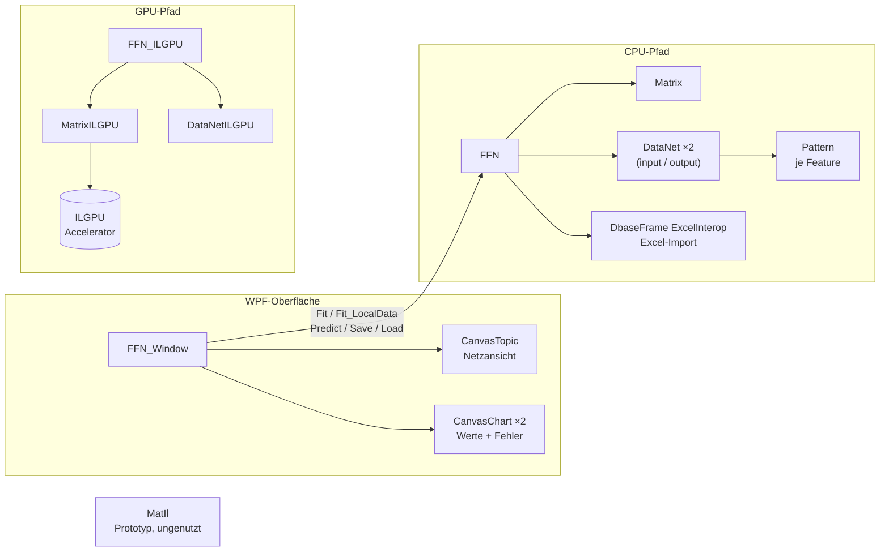
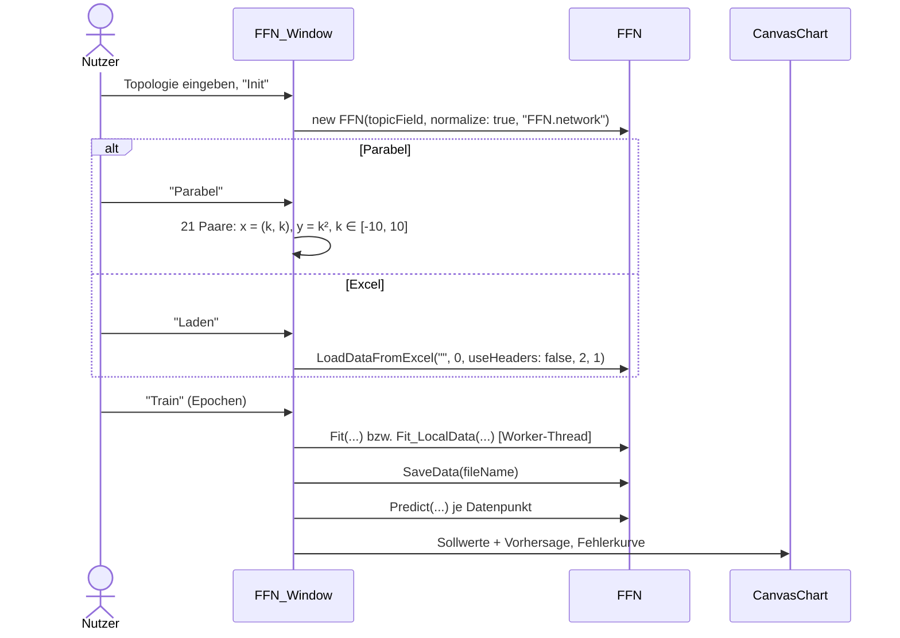

# MatrixFFN: Architektur

> Grundlage ist der Code-Stand in deinem OneDrive (`C# local für GitHub/MatrixFFN`):
> `FFN` 1.0.20 (07.10.24), `FFN_ILGPU` 1.0.9 (05.10.24), `FFN_Window` 1.0.17 (11.10.24),
> `Matrix` 1.1.9, `DataNet` 1.0.12, `Pattern` 1.0.11.
> Nicht im Detail gelesen: `MatrixILGPU.cs`, `DataNetILGPU.cs`, `CanvasChart.cs`, `CanvasTopic.cs`, `StopWatch.cs` (siehe Abschnitt 12).

---

## 1. Überblick

MatrixFFN ist ein klassisches Feed-Forward-Netz mit Sigmoid-Aktivierung und beliebig vielen Hidden-Layern, komplett in C# ohne ML-Framework geschrieben. Die gesamte Mathematik läuft über eine eigene `Matrix`-Klasse. Dazu gehören:

- eine **automatische Datennormalisierung** (`DataNet` / `Pattern`), die auch die Lernraten je Feature ableitet,
- eine **WPF-Oberfläche** (`FFN_Window`) zum Definieren, Trainieren, Speichern und Visualisieren von Netzen,
- ein **GPU-Zwilling** (`FFN_ILGPU`), der die gleiche Logik über ILGPU-Kernels rechnet,
- **Excel-Import** der Trainingsdaten über `FFN.ReadExcelData` mit `ExcelInterop` aus DbaseFrame (seit 27.11.26,
  vorher `NPOIexcel` aus NPOIwrap),
- seit 27.11.26 zugleich **Demoprogramm** (`App`, `MainWindow`, aus ILGPU-Test übernommen) und NuGet-Paket.



`FFN_Window` arbeitet ausschließlich mit `FFN`. `FFN_ILGPU` ist eine eigenständige Bibliotheksklasse und hängt nicht an der Oberfläche.

---

## 2. Projektstruktur

| Datei | Rolle |
|---|---|
| `FFN.cs` | Das Netz (CPU): Aufbau, Predict, Train, Fit, Normalisierung, Speichern/Laden, Excel-Import |
| `FFN_ILGPU.cs` | Zwilling von `FFN`, rechnet über `MatrixILGPU` auf der GPU |
| `FFN_Window.xaml(.cs)` | WPF-Oberfläche: Topologie eingeben, Datensatz wählen, trainieren, Charts |
| `Tools/Matrix.cs` | Matrixrechnung (Falk-Schema), Sigmoid, Ableitung, Binär-I/O |
| `Tools/MatrixILGPU.cs` | Gleiche API als ILGPU-Kernels |
| `Tools/DataNet.cs` | Normalisierung einer ganzen Schicht (Liste von `Pattern`) |
| `Tools/DataNetILGPU.cs` | `DataNet`-Variante für den GPU-Pfad |
| `Tools/Pattern.cs` | Lineare Abbildung eines Features auf [0,25; 0,75], liefert die Lernrate je Feature |
| `Tools/CanvasChart.cs`, `CanvasTopic.cs`, `CanvasWindow.xaml(.cs)` | Zeichnen von Charts und Netztopologie |
| `Tools/StopWatch.cs`, `Message.cs` | Zeitmessung, Meldungsfenster |
| `MatIl.cs` | Früher ILGPU-Prototyp (eigener Namespace `Matrix2DimILGPU`, leerer Kernel) |
| `Testdaten_Parabel.xlsx` | Parabel-Datensatz als Excel-Version |
| `api/`, `_site/` | docfx-Dokumentation (generiert) |

---

## 3. Die Matrix-Konvention

Das ist der wichtigste Schlüssel zum Lesen des Codes, weil er von der üblichen Schreibweise abweicht.

- `Matrix(sizeX, sizeY)` speichert `data[posX, posY]`. **`sizeX` sind die Spalten, `sizeY` die Zeilen** (das sieht man an `ToString()`, das zeilenweise über `posY` ausgibt).
- `Matrix.Multiply(m1, m2)` verlangt `m1.sizeX == m2.sizeY` und liefert `[m2.sizeX, m1.sizeY]`. Mathematisch ist das das normale Produkt **m1 · m2**.
- `FromArray(x)` erzeugt `[n, 1]`: n Spalten, 1 Zeile, also einen **Zeilenvektor**.
- `FromArrayTranspose(x)` erzeugt `[1, n]`: einen **Spaltenvektor**.
- Das Suffix **`T`** in Feldnamen (`netLayersT`, `biasT`, `gradientT` …) bedeutet daher: **Spaltenvektor**.

Jede Operation gibt es in drei Formen:

| Form | Beispiel | Speicher |
|---|---|---|
| Instanzmethode, ändert die eigene Matrix | `m.AddMatrix(b)` | keine Allokation |
| statisch mit Rückgabe | `Matrix.Multiply(a, b)` | neue Matrix |
| statisch mit Ziel (`_Target` / 3. Parameter) | `Matrix.Multiply(a, b, target)` | keine Allokation, „best speed“ |

Im Trainingspfad wird konsequent die Ziel-Variante benutzt, damit der Garbage Collector nicht anspringt (Designziel laut README).

---

## 4. Netzaufbau

Die Topologie steht in `layersTopic`, z. B. `{ 2, 4, 1 }` (Input, Hidden…, Output). Im Folgenden ist **n_l** die Neuronenzahl von Schicht l und **L** der Index der Output-Schicht. Alle Matrizen werden **einmal im Konstruktor** angelegt; danach ändert sich keine Form mehr.

| Feld | Anzahl | Form (mathematisch, Zeilen × Spalten) | Inhalt |
|---|---|---|---|
| `weights[l]` | L | n_(l+1) × n_l | Gewichte, Start zufällig in [-1, 1] |
| `weightsT[l]` | L | n_l × n_(l+1) | transponierte Gewichte für die Fehlerrückführung |
| `deltaWeights[l]` | L | wie `weights` | Korrektur des letzten Schritts |
| `weightsLearnrates[l]` | L | wie `weights`, alle 1 | Hilfsmatrix zum Weiterreichen der Lernraten |
| `biasT[l]` | L+1 | n_l × 1 | Bias (`biasT[0]` wird nie benutzt) |
| `netLayersT[l]` | L+1 | n_l × 1 | Aktivierungen der Schicht |
| `netLayers[l]` | L+1 | 1 × n_l | dieselben Aktivierungen als Zeilenvektor |
| `layersErrorT[l]` | L+1 | n_l × 1 | Fehler je Neuron |
| `gradientT[l]` | L+1 | n_l × 1 | Gradient inkl. Lernraten |
| `learnRateT[l]` | L+1 | n_l × 1 | Lernrate je Neuron (Hidden: 0,1) |
| `learnRateTprev[l]` | L+1 | n_l × 1 | Lernrate, die aus der Vorschicht kommt |

---

## 5. Vorwärtsrechnung (`Predict`, Vorwärtsteil von `Train`)

```
a_0     = x                              (normalisiert, wenn normalizeData)
a_(l+1) = σ( W_l · a_l + b_(l+1) )       für l = 0 … L-1
y       = a_L                            (denormalisiert, wenn normalizeData)

σ(z) = 1 / (1 + e^(-z))
```

`Predict` legt dabei bei jedem Aufruf neue Matrizen an (`Matrix.Multiply` mit Rückgabe). `Train` schreibt dagegen in die vorbereiteten Felder (`netLayersT[l+1]`) und hält beide Lagen (`netLayers`/`netLayersT`) per `Transpose` synchron.

---

## 6. Training (`Train` / `Train_LocalData`)

Ein Trainingsschritt läuft für **ein** Musterpaar in drei Schleifen:

**1. Vorwärts** wie in Abschnitt 5.

**2. Fehler und Gradienten** von hinten nach vorne (l = L … 1):

```
e_L = t − a_L                             (Zielwert minus Ausgabe)
e_l = W_lᵀ · e_(l+1)                      für 0 < l < L
g_l = a_l ⊙ (1 − a_l) ⊙ e_l ⊙ η_l  [ ⊙ η'_l ]      (η' nur bei Normalisierung)
```

**3. Korrektur** (l = L … 1):

```
ΔW_(l-1) = g_l · a_(l-1)ᵀ                 (äußeres Produkt)
W_(l-1) += ΔW_(l-1) ;  weightsT neu transponieren
b_l     ⊙= g_l                            (Befund H2: gewollt, Vorgabe vom 27.11.26, eigenes Thema)
```

Rückgabe ist `MS_Sum` des Output-Fehlers, also Σ e², die **Summe der quadrierten Fehler** (nicht die Wurzel, obwohl der Kommentar das sagt).

**Abweichung vom Lehrbuch-Backprop:** Zurückgereicht wird der Fehler `e`, nicht das Delta `g`. Die Ableitungen und Lernraten der höheren Schichten fließen also nicht in die unteren ein. Das ist die bekannte vereinfachte Form („hidden_errors = Wᵀ · output_errors“) und funktioniert für flache Netze ordentlich. Bei mehreren Hidden-Layern werden die Gradienten in den unteren Schichten aber zu groß im Verhältnis zum echten Gradienten. Die Reihenfolge stimmt: Erst werden alle Fehler berechnet, danach werden alle Gewichte geändert.

---

## 7. Normalisierung und Lernraten

### Pattern: ein Feature

`Pattern` bildet ein Feature linear von [min, max] auf **[0,25; 0,75]** ab. Der Rand zur Sigmoid-Sättigung bleibt frei, damit auch Ausreißer noch korrigiert werden können:

```
normiert = 0,25 + (x − min) / (max − min) · 0,5
```

Gespeichert werden außerdem `steps = (max − min) / kleinster Abstand zweier verschiedener Werte` und daraus `learnValue = 1 / steps`. Je feiner ein Feature aufgelöst ist, desto kleiner ist also seine Lernrate.

### DataNet: eine Schicht

`DataNet.DataNetInit(daten)` erzeugt für jede Spalte ein `Pattern` und liefert die `learnValue`s als Spaltenvektor zurück. Es gibt zwei Instanzen: `dNetInput` und `dNetOutput`.

### Wie die Lernraten im Netz landen (`FFN.DataNetInit`)

```
η_0   = learnValues der Input-Features      (learnRateT[0])
η_L   = learnValues der Output-Features     (learnRateT[L])
η_l   = 0,1 für Hidden-Layer                (Konstruktor)
η'_l  = Σ η_(l-1)   (jedes Element gleich)  (learnRateTprev[l] = weightsLearnrates · learnRateT[l-1])
```

**Beispiel Parabel** mit Topologie `{ 2, 4, 1 }`: x ∈ [-10, 10] in Einerschritten ergibt `steps = 20`, also η = 0,05 je Input. y ∈ [0, 100] ergibt `steps = 100`, also η = 0,01.
- Hidden-Layer: Faktor 0,1 · (0,05 + 0,05) = **0,01**
- Output-Layer: Faktor 0,01 · (4 · 0,1) = **0,004**

Die effektiven Lernraten sind damit klein und hängen von der Auflösung der Daten ab. Das erklärt, warum das Netz viele Epochen braucht.

`DataNetInit` läuft nur, solange `epochsNumber == 0` ist, also nur beim ersten `Fit`.

---

## 8. Epochen (`Fit` / `Fit_LocalData`)

- `Fit(inputs, outputs, epochen)` arbeitet mit übergebenen Arrays und normalisiert in jedem `Train`-Aufruf neu.
- `Fit_LocalData(epochen)` arbeitet mit den per `LoadDataFromExcel` geladenen Daten. `InitLocalData()` normalisiert sie **einmal vorab** in `localNetLayers0` / `localtargetT`, was schneller ist.
- In jeder Epoche werden alle Muster zufällig ohne Zurücklegen gezogen (`drawPool`; bis 27.11.26 nur etwa die Hälfte, Befund H3).
- Danach wird `errorMedian = errorSum / epochen` in `listErrorAmount` / `listEpochs` geschrieben. Das ist die Kurve im Fehler-Chart.

---

## 9. Datenfluss in der Oberfläche



**Automatik-Training** (`AutomaticLoop`): Trainiert in Blöcken. Wird der Fehler schlechter, lädt die Schleife den letzten Stand neu, sonst speichert sie. Das ist eine einfache „Checkpoint/Rollback“-Strategie. Achtung: Befund H6.

**Threading:** Die UI-Werte, die der Worker braucht (Epochen, Checkboxen, Node-Nummern), werden in Felder gespiegelt (`textBoxInputEpochs`, `datasetCheckParable` …). UI-Updates laufen über `Dispatcher.Invoke` (`ForwardUi…`).

---

## 10. Speichern und Laden

`SaveData` / `LoadData` schreiben bzw. lesen einen eigenen **Binärstrom** (`BinaryWriter`) in fester Reihenfolge:

`biasT` → Dateiname → `deltaWeights` → `deltaWeightsT` → `dNetOutput` → `dNetInput` → `epochsNumber`, `errorMedian`, `errorSum` → `weights` → `weightsT` → `gradientT` → `learnRateT` → `netLayers` → `netLayersT` → `normalizeData` → `layersNo` → `layersTopic` → `layersErrorT` → `targetT` → Zeit-Strings → `workingTopic` → `listEpochs` → `listErrorAmount` → `adaptLernRate`, `adaptLernRateOld` → `fitText`

Jede Matrix speichert `sizeX`, `sizeY` und dann die Werte. Jedes `Pattern` speichert `wertReal`, `min`, `max`, `steps` und rechnet den Rest beim Laden neu.

**Nicht gespeichert** werden `weightsLearnrates` und `learnRateTprev` (siehe Befund M2). Gespeichert werden dagegen reine Zwischenstände (`deltaWeights`, `gradientT`, `layersErrorT`, `netLayers`), die zum Weiterrechnen nicht nötig sind.

Es gibt keine Format-Version im Header. Jede Änderung an der Reihenfolge macht alte `.network`-Dateien unlesbar.

---

## 11. CPU- und GPU-Pfad

`FFN_ILGPU` ist fast zeilengleich zu `FFN`, nur mit `MatrixILGPU` und `DataNetILGPU`. Jede Matrixoperation wird nach dem Muster aus der README auf die GPU gebracht:

1. `Action<Index2D, ArrayView2D<…>, …>`-Feld deklarieren
2. im Konstruktor per `accelerator.LoadAutoGroupedStreamKernel(...)` laden
3. die Schleife als Kernel schreiben: Die Position (`index.X`, `index.Y`) ersetzt die `for`-Schleifen
4. in der ursprünglichen Methode die `Action` aufrufen, `Synchronize()`, Ergebnis zurückholen

**Architektur-Konsequenz:** Laut README-Beispiel legt jede Operation eine neue `MatrixILGPU` an, synchronisiert und kopiert das Ergebnis per `GetAsArray2D()` **zurück auf die CPU**. Ein Trainingsschritt besteht aus vielen kleinen Operationen. Bei kleinen Netzen kostet dieser Hin- und Rücktransport deutlich mehr als die Rechnung selbst, deshalb ist die GPU-Version dort voraussichtlich langsamer als die CPU-Version. Ein echter Gewinn entsteht erst, wenn die Daten zwischen den Operationen auf der GPU bleiben und größere Blöcke (Batches statt einzelner Muster) gerechnet werden.

Unterschiede zwischen den Zwillingen, die über die Typen hinausgehen:

| Stelle | `FFN` | `FFN_ILGPU` |
|---|---|---|
| Bias in `Predict` | `biasT[pos + 1]` | `biasT[pos]` (Befund H5) |
| Datenprüfung in `Fit` / `DataNetInit` | `==` | `!=` (Befund H4) |
| `deltaWeights` in `Train` | Ziel-Variante | neue Matrix je Schritt |
| `LoadDataFromExcel` | gibt `bool` zurück, MessageBox bei Abbruch | `void`, liest Header immer |
| `Predict_LocalData`, `ToString`, `Print` | vorhanden | fehlt |

`MatIl.cs` ist ein früher Prototyp (`float`, eigener `Context` je Instanz, leerer Multiplikations-Kernel). Er wird von keiner anderen Klasse benutzt.

---

## 12. Befunde

Gefunden beim Lesen des Codes, nicht durch Ausführen. Zeilennummern beziehen sich auf den aktuellen Stand.

### Hoch: beeinflusst das Lernergebnis oder bricht ab

**Stand 27.11.26:** H1 und H3 in `FFN` behoben, H4 und H5 in `FFN_ILGPU` behoben. **H2 bleibt** (Vorgabe des Nutzers vom
27.11.26: der multiplizierte Bias wird ein eigenes Thema). Mit H1 + H3 und multipliziertem Bias: `Fit` 5/8, `Fit_LocalData`
5/8 gelernt (Median 6,3 bzw. 4,9). Versuchsweise mit addiertem Bias (H1 + H2 + H3, zurückgenommen): Messung Parabel (21 Muster, Netz {2, 40, 20, 10, 1},
2000 Epochen, je 8 Läufe): Die Läufe enden entweder gelernt (Fehler ≈ 3) oder festgefahren (≈ 25–28, Ausgabe nahe
dem Mittelwert). Gelernt (Fehler < 8) vorher `Fit` 0/8, `Fit_LocalData` 4/8; nach H1–H3 `Fit` 7/8, `Fit_LocalData`
8/8; Median 25,7 → 4,0 bzw. 12,6 → 3,8. H3 allein brachte `Fit` auf 5/8, H2 allein war bei dieser Streuung nicht
messbar. Vorher lernte `Fit_LocalData` besser als `Fit`, weil durch H1 die erste Gewichtsschicht gar nicht lernte.
In `FFN_ILGPU` ebenfalls H1 und H3 sowie H4 und H5 behoben (Messwerte dort noch mit addiertem Bias); geprüft nur auf der CPU-Emulation von ILGPU
(`CUDA_VISIBLE_DEVICES=-1`, sehr langsam): `Predict` und `Fit` laufen, der Fehler sinkt (`Fit` 101 → 60 nach
30 Epochen, `Fit_LocalData` 101 → 64 nach 10). Gleichwertigkeit mit `FFN` nicht gemessen. Auf der RTX 5060 Ti
(Rechenfähigkeit 12.0) scheitert ILGPU 1.5.1 weiter im Konstruktor („PTX JIT compilation failed“).

| # | Ort | Problem | Vorschlag |
|---|---|---|---|
| H1 | `FFN.Train_LocalData` (Z. 863 / 901) | `netLayers[0]` wird nie gesetzt (die Zeile ist auskommentiert), nur `netLayersT[0]`. Die Korrektur der ersten Gewichtsmatrix rechnet daher mit Nullen (neues Netz) oder mit einem veralteten Muster (nach `Train` oder `LoadData`). **Mit Excel-Daten lernt die erste Schicht praktisch nicht.** | nach Z. 863: `netLayers[ 0 ] = localNetLayers0[ sampleN ];` (nur Referenz, keine Allokation) |
| H2 | `FFN.Train` Z. 831, `Train_LocalData` Z. 906 (ebenso in `FFN_ILGPU`) | Bias wird **multipliziert** (`biasT[pos].MultiplySameSize(gradientT[pos])`). Da g klein ist, fällt der Bias nach wenigen Schritten auf ≈ 0, das Netz rechnet faktisch ohne Bias. Dein Kommentar „Multiply/Add ?“ trifft genau das. | **nicht ändern** (Vorgabe des Nutzers vom 27.11.26: gewollt, wird eigenes Thema) |
| H3 | `FFN.Fit` Z. 960, `Fit_LocalData` Z. 1030 | Die `for`-Schleife läuft bis `drawPool.Count`, während `RemoveAt` die Liste verkürzt. Pro Epoche wird so nur **die Hälfte der Muster** trainiert (Parabel: 11 von 21). | `while ( drawPool.Count > 0 ) { … }` |
| H4 | `FFN_ILGPU` Z. 849/851, 920/922, 989/991 | Datenprüfung invertiert (`okData &= ( … != … )`). Bei **passenden** Daten wird `ArgumentException` geworfen. `Fit`, `Fit_LocalData` und `DataNetInit` sind damit unbenutzbar. | `!=` → `==` wie in `FFN` |
| H5 | `FFN_ILGPU.Predict` Z. 661 | `biasT[ pos ]` statt `biasT[ pos + 1 ]`. Sobald zwei benachbarte Schichten verschieden groß sind, wirft `AddMatrix` eine Exception, sonst wird der falsche Bias addiert. | `biasT[ pos + 1 ]` |
| H6 | `FFN_Window._ButtonAutomaticTraining_Click` | `autoLoopTask = new Task(...)` wird nie gestartet. Das **Automatik-Training läuft nicht**. | `autoLoopTask = Task.Run( () => { … } );` |

### Mittel: falsche Werte oder Absturz in bestimmten Abläufen

| # | Ort | Problem | Vorschlag |
|---|---|---|---|
| M1 | `FFN.LoadData` Z. 516–517 | `errorMedian` und `errorSum` werden als `double` geschrieben, aber mit `ReadInt64()` gelesen. Nach dem Laden stehen Unsinnswerte drin (nur Anzeige betroffen). | `reader.ReadDouble()` |
| M2 | `SaveData` / `LoadData`, Konstruktor `FFN(string)` | `learnRateTprev` und `weightsLearnrates` werden nicht gespeichert, und `DataNetInit` läuft nach dem Laden nicht mehr (`epochsNumber > 0`). **Nach dem Laden trainiert das Netz mit anderen Lernraten** als vorher (Startwert 0,1 statt der berechneten). Mit dem Konstruktor `FFN(string)` sind die Felder sogar zu kurz, dann gibt es beim Training eine `IndexOutOfRangeException`. | beide Felder mitspeichern oder nach `LoadData` aus `learnRateT` neu berechnen |
| M3 | `FFN_Window._ButtonTrain_Click` | Der Worker-Thread ruft `_ButtonPredict_Click` direkt auf, das die Charts aktualisiert. Wenn `CanvasChart` nicht selbst über den Dispatcher geht, gibt das eine Cross-Thread-`InvalidOperationException`. | `ForwardUiPredictNow();` (gibt es schon, `AutomaticLoop` nutzt es) |
| M4 | `FFN_Window`: `_TextBoxInputEpochs_TextChanged`, `_TextBoxShowIn/Out_TextChanged` | `int.Parse` auf leeren Text, sobald jemand die Box leert, führt zu einer `FormatException`, die die App beendet. Die Regex im `PreviewTextInput` verhindert nur falsche Zeichen, nicht das Löschen. | `int.TryParse(...)` und bei Fehler den alten Wert behalten |
| M5 | `FFN.SetLearningRate` | `Matrix.MultiplyScalar(weightsLearnrates[pos], …, learnRateTprev[pos+1])` schreibt eine n_l × n_(l+1)-Matrix in einen n_(l+1) × 1-Vektor. Der Größencheck wirft immer, sobald die Vorschicht mehr als ein Neuron hat. Die Methode wird derzeit nicht aufgerufen. | `learnRateTprev[pos+1]` direkt mit `target` füllen bzw. den Faktor auf die bestehenden Werte anwenden |
| M6 | `DataNet.DataNetInit` | Den kleinsten Abstand sucht die Methode über alle Paare (O(n²)): bei 10 000 Zeilen sind das 100 Mio. Vergleiche. Hat ein Feature nur einen Wert, wirft `.Min()` auf einer leeren Folge eine `InvalidOperationException`. | Werte sortieren und benachbarte Differenzen nehmen (O(n log n)), konstantes Feature abfangen |

### Niedrig: Aufräumen

| # | Ort | Problem | Vorschlag |
|---|---|---|---|
| N1 | `FFN.SaveData` | `File.OpenWrite` kürzt eine vorhandene Datei nicht. Ist die neue Datei kürzer, bleibt alter Rest am Ende stehen. Beim Lesen ist das harmlos, aber unsauber. | `File.Create(fileName)` |
| N2 | `Matrix.MS_Sum` | Kommentar sagt „Wurzel“, zurück kommt die Quadratsumme (`sqrtsum` bleibt ungenutzt). `MS_Sum(Matrix, double sum)` verliert das Ergebnis, weil `sum` kein `out` ist. | Kommentar anpassen, Overload auf `out double` umstellen oder entfernen |
| N3 | `FFN_Window._ButtonDatasetLoad_Click` | Excel-Import fest mit `useHeaders: false, 2 Inputs, 1 Output`. Die README beschreibt die Erkennung über die Header „input/output“. | Header-Variante nutzen oder die Zahlen aus der Topologie nehmen |
| N4 | `FFN.Predict`, `Train` | `Predict` (und in `Train` `FromArray`/`FromArrayTranspose`) allokieren bei jedem Aufruf, entgegen dem GC-Ziel aus der README. | vorbereitete Felder wie in `Train_LocalData` nutzen |
| N5 | `Fit` / `Fit_LocalData` | `errorMedian` ist der Fehler **pro Epoche** (Summe über alle Muster), nicht pro Muster. Die Zeile „medium error / epochs“ teilt ein zweites Mal. | durch Musterzahl teilen, Beschriftung anpassen |
| N6 | `MatIl.cs` | ungenutzter Prototyp | in einen `Experiments`-Ordner verschieben oder löschen |
| N7 | Speicherformat | keine Versionskennung | Magic-Bytes und Formatversion an den Anfang schreiben |

### Nicht geprüft

`MatrixILGPU.cs` (87 KB), `DataNetILGPU.cs`, `CanvasChart.cs`, `CanvasTopic.cs`, `CanvasWindow`, `StopWatch.cs`, die XAML von `FFN_Window` und das Verhalten von `NPOIexcel` habe ich nicht im Detail gelesen. Insbesondere bei M3 hängt die Auswirkung davon ab, ob `CanvasChart` intern dispatcht.

---

## 13. Empfohlene Reihenfolge

1. ~~**H1, H3** in `FFN` beheben~~ (erledigt 27.11.26, Messung oben unter „Hoch“). **H2 bleibt** (Vorgabe des
   Nutzers, eigenes Thema).
2. **H6** (Automatik starten) und **M3/M4** (Threading, leere Textboxen) in der Oberfläche.
3. **M1/M2**, damit gespeicherte Netze nach dem Laden genauso weiterlernen.
4. ~~Die gleichen Korrekturen in **`FFN_ILGPU`** übernehmen, plus **H4/H5**~~ (erledigt 27.11.26; offen: ILGPU auf
   der RTX 5060 Ti, Gleichwertigkeit mit `FFN` auf echter Grafikkarte messen).
5. Längerfristig: die gemeinsame Logik von `FFN` und `FFN_ILGPU` über ein Interface oder eine Basisklasse mit austauschbarem Matrix-Backend zusammenführen, damit Korrekturen nicht doppelt gemacht werden müssen.
